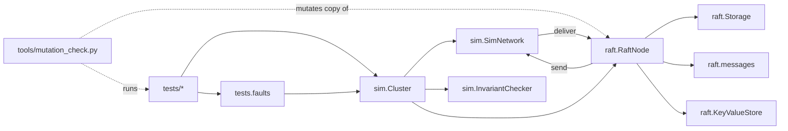
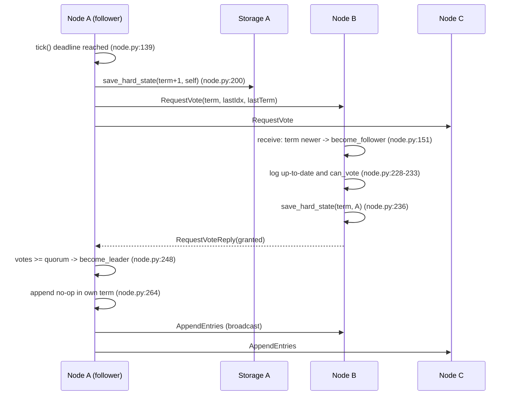
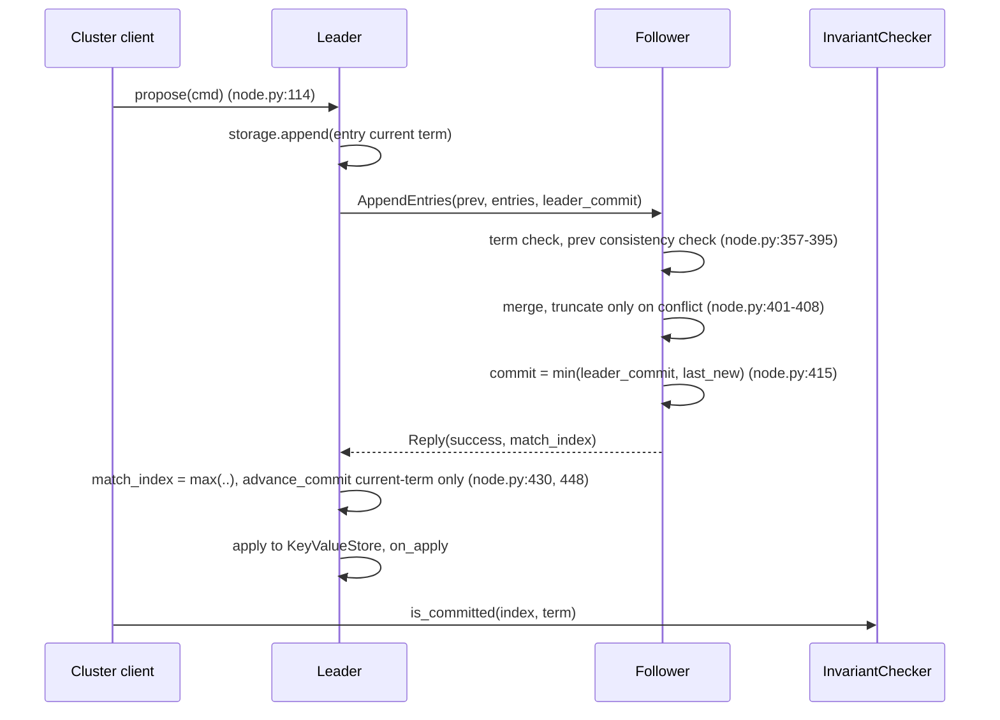

# Architecture

## Architecture Analysis

### System Overview
A library (`raft/`) containing a pure, single-threaded Raft state machine, and a test world (`sim/`) that drives clusters of nodes on logical time. Nodes expose `tick()`, `receive(src, msg)` and `propose()`, and emit messages through an injected `send` callable (raft/node.py:1-11, 49-64). Durable state lives in an injected `Storage`.

### Architectural Style
Deterministic, event-driven state machine behind ports (send, storage, rng), driven by a discrete-event simulator. Not a networked service: no sockets, threads, clock or serialisation exist anywhere.

### Component Relationships

Text fallback: tests drive Cluster; Cluster owns SimNetwork, InvariantChecker and RaftNodes; RaftNode uses Storage, messages and KeyValueStore; the network delivers to nodes and nodes send back via the network; the mutation tool mutates a copy of node.py and runs the tests.

### Data Flow
Client command -> `Cluster.commit` -> leader `propose` -> log append -> AppendEntries via SimNetwork -> follower merge -> success reply -> leader `_advance_commit` -> `_apply_committed` -> `on_apply` records results; `InvariantChecker.is_committed` is how the harness decides a command is acknowledged (sim/cluster.py:204-205, 229).

### Key Design Decisions
- Logical time, node as pure state machine (D3/D4 in docs/design-decisions.md): reproducible seeds, no real concurrency tested.
- Crash = drop node, keep Storage (D5): persistence order is only documented, never interrupted.
- Reads go through the log (D9): linearizable, slow.
- PreVote/CheckQuorum off by default (D8).
- Safety asserted every tick by an external checker that reads node internals (D6).

### Improvement Opportunities
See code-quality-assessment.md (single place for findings).

## Interaction Diagrams

### Leader election (base, no PreVote)

Text fallback: candidate persists term+vote, requests votes; voters step up their term, check log freshness, persist the vote, reply; majority makes the candidate leader, which appends a no-op and broadcasts AppendEntries.

### Log replication and commit

Text fallback: leader appends and sends AppendEntries; follower checks the previous entry, merges without needless truncation, caps its commit index at the verified prefix and replies; the leader advances match_index and commits only current-term entries; the harness learns commitment from the checker.

### Rejection and backtracking
Follower reply carries conflict_index/conflict_term (node.py:376-395); leader jumps next_index using the last index of that term (node.py:435-446) and resends immediately.
