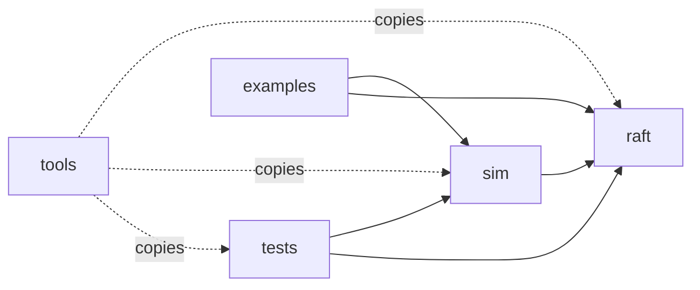

# Dependencies

## External
- pytest: required by tests and tools/mutation_check.py (invoked as `python -m pytest`, tools/mutation_check.py:86); not declared in pyproject.toml (no `dependencies` or optional extras). No version pin.
- mypy: referenced in README.md:136 only.
- Everything else is the Python standard library.
- No known-vulnerability concern (no third-party runtime code).

## Internal

Text fallback: tests and examples depend on sim and raft; sim depends on raft; raft depends on nothing outside itself. sim/invariants.py imports `RaftNode` (a one-way dependency from harness onto the implementation). The mutation tool copies raft, sim, tests and pyproject.toml (tools/mutation_check.py:98) and edits only raft/node.py (line 26).
